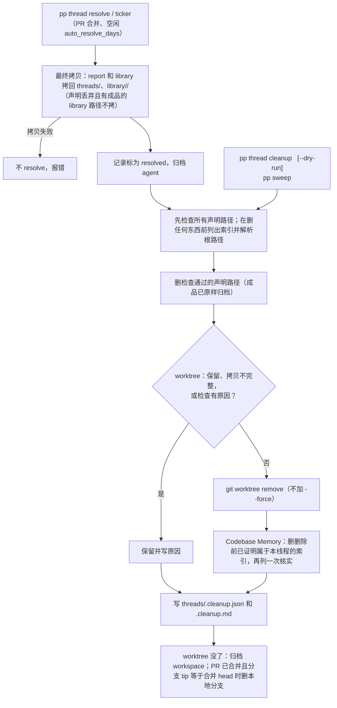

# 线程 resolve 后的清理

线程 resolve 时自动清理它留下的东西。只删能确认属于这个线程、并且确实可以丢掉的东西；拿不准就保留，并写下原因。

resolve 自动触发、`pp thread cleanup` 重试、`--dry-run` 预览和 `pp sweep` 用的是同一份实现：`orchestrator/cleanup.mjs` 里的 `run`。

## 归属规则（只有这一条）

先检查完、列出索引，最后才删：

- 能删的只能是一个真实路径，并且在删任何东西之前就解析好。它必须在本线程自己的目录里，或者在 `<tmp>/<id>-…` 下。
- 它不能碰任何线程目录：不能是线程目录、不能是线程目录的祖先、不能装着线程目录，只能在本线程目录的内部。
- 它不能和任何声明保留的路径重叠，祖先和子孙都算。
- 一个索引属于本线程，只有两种情况：它的根在删除前就解析到本次删掉的路径里；或者本线程之前的清理记录里登记过它删除失败（名字和根都要对上）。重试时，它的根现在解析出的真实路径必须和当时记录的一致，当时证明归属的那个已删目录也必须仍然不存在；路径被重新占用或改指向（例如变成指向主 checkout 的链接）就保留，旧记录没有真实根就跳过。
- 不存在的路径证明不了任何归属：除非之前的运行删过它，否则记为 skipped，也不会拿它当删索引的依据。



## 自动处理的

| 资源 | 什么时候删 | 怎么判断归属 |
|---|---|---|
| 线程的 worktree | 下面所有检查都通过 | 记录里的 `cwd`；`pwd -P` 必须等于 `git rev-parse --show-toplevel`，并且登记在 `t.repo` 的 `git worktree list` 里，不能是主 checkout |
| worktree 里的 `node_modules/` | 跟着 worktree 一起删 | 里面有 `.package-lock.json` 或 `.modules.yaml`，同级或根目录有 git 跟踪的 lockfile，而且它本身不是符号链接 |
| `.paseo-project/<本线程>/` | 跟着 worktree 一起删 | 只有 brief、report、cleanup.json、library（已经拷回家），或者声明丢弃的路径 |
| 声明丢弃的路径 | 检查通过就 `rm -rf` | 见下面的 `cleanup.json` |
| Codebase Memory 索引 | 删除前解析的 `root_path` 在本次删掉的目录里，或者之前的记录登记过它 | 用官方 CLI `codebase-memory-mcp cli --json list_projects / delete_project`，删完再列一次核实。经过符号链接的根按链接实际指向判断；断掉的链接不算 |
| 已合并的本地分支 | worktree 已经没了，分支 tip 等于合并的 head | 和原来一样 |

worktree 删除前要满足这些条件，任何一条不满足就保留并写原因：

- HEAD 在某个分支或 tag 上能找到；
- 没有 checkout 出来的子模块，git 目录下也没有 `modules/`。空的（未初始化的）子模块可以删；
- 没有未提交改动、untracked 文件，也没有不认识的 ignored 内容；
- 用 `lsof` 确认没有进程打开里面的文件。重试 5 次，每次间隔 1 秒，等刚归档的 agent 退出。没有 `lsof` 就保留。

删除只用 `git worktree remove -- <path>`，不加 `--force`，不跑 `git worktree prune`（它会处理整个仓库），也不跑 `submodule deinit`。worktree 目录已经不在时：如果它还登记在 `t.repo` 里，只移除这一条登记，移除失败记为 failed；如果没登记，就记为 gone，它下面的索引不动。

## 保留的（写明原因）

- `--keep-worktree`，或 `cleanup.json` 里有 `keep`：worktree 保留。sweep 和重试也不会删它（Paseo 的合并自动归档会绕过保留，见下文）。
- 最终拷贝不完整：worktree 保留。`thread resolve --force` 可以删。
- `cleanup.json` 解析不了：不知道哪些要保留，所以全部保留。
- worktree 里有原因的内容：untracked、未提交改动、不认识的 ignored 内容（trace、log、报告、out/ 等）、其他线程的目录。
- 声明的路径是这些情况：符号链接、不在本线程目录或 `/tmp/<id>-…` 下、碰到线程目录（本线程的或别的线程的，或者装着线程目录）、和声明保留的路径重叠、有 git 跟踪的文件；在 library 里但没指明成品，或者成品不存在、不是普通文件、为空、没有原样归档到 home。
- 另一台机器上的线程：不清理声明的路径和索引，worktree 的检查照常通过 ssh 运行。
- 没装 `codebase-memory-mcp`：索引标为 skipped。

默认保留报告、日志、trace、session、脚本、GIF/QA 成品，以及其他没有声明的东西。依赖和原始帧不会搬进 library。

## `cleanup.json`：线程的显式登记

线程把它写在自己的目录里（`.paseo-project/<project>-<id>/cleanup.json`）。相对路径从这个目录算起：

```json
{
  "discard": [
    { "path": "library/rec/frames", "product": "library/rec/demo.gif", "why": "demo.gif 的原始帧" },
    { "path": "/tmp/t-1005-scratch", "why": "测试用的临时目录" }
  ],
  "keep": [{ "path": ".", "why": "用户要看现场" }]
}
```

- `discard` 只能是本线程 worktree（或 tab 目录）里的路径，或者是 `/tmp`、系统临时目录下以 `<线程 id>-` 开头的目录。
- library 里的路径必须带 `product`。成品必须是 library 里非空的普通文件，最终拷贝时不拷原始帧；删除前还要核对 home 里那份成品的 sha256 和 worktree 里的一致。
- 只要有 `keep`，worktree 就整个保留；和 keep 重叠的 discard 也保留，临时目录和 tab 线程也一样。
- 声明会写进清理记录，所以即使 worktree 删掉了，重试时也还能用这份声明。

## 记录与重试

每次运行都会重写这两个文件：

- `threads/<id>.cleanup.json`：`run`、`state`（`complete`，或有 failed 时为 `partial`）、`archive`（这次最终拷贝的结果：`complete`、`partial`、`missing`（附 `archive_missing`）、`unknown`（家里有 library 但没有完整拷贝的记录，附 `archive_unknown`）、重试时可能是 `failed`，用 `--skip-copy` 时为 `skipped`）、`removed_kib`，以及每一项的 kind、target、status（removed、gone、kept、failed、skipped）、reason、kib，还有这次用的声明。
- `threads/<id>.cleanup.md`：同样内容的表格。

几个规则：

- 字节数来自删除前的 `du -sk`。共享或克隆的块不算在内，所以它不保证真的释放了这么多空间。
- 之前删掉的项，在之后的运行里显示为 gone 时，保留原来那次删除的记录。
- 失败不会被吞掉，也不会被当成成功：thread 照样 resolve，记录标为 `partial`，inbox 里写明失败的项。`pp thread cleanup <slug> <id>` 重试，重试是幂等的。
- 再次 `thread resolve` 会报错，并提示改用 `thread cleanup`。
- `--dry-run` 走同样的检查，会列出 would-remove，不删东西，也不写记录。它不会重新拷贝，所以 library 里的成品可能还没归档。
- `pp sweep` 会对 resolved 线程残留的 worktree 再跑一次 `thread cleanup`，跳过保留的。不属于任何线程的 `pp-<slug>-t-NNNN` worktree 也走同样的 worktree 检查。

## 和 Paseo 的合并自动归档冲突

Paseo daemon 的 `daemon.autoArchiveAfterMerge`（默认关闭）打开时，会在 PR 合并后自动归档 workspace。触发条件只有这几条：PR 合并、git 不脏、没有领先 origin、worktree 归 Paseo 所有。满足后它用 `git worktree remove --force`、`rm -rf` 和 `git worktree prune` 删掉 worktree。它不看 pp 的保留决定，不看 ignored 内容（`.paseo-project/` 也在其中），也不看占用的进程。pp 的线程 worktree 都是 Paseo 创建的，所以这个设置打开时，删 worktree 的就不止 pp 一家：

- pp 先 resolve、决定保留时：保留守不住。记录里 worktree 的 kept 原因会写明这一点，`pp doctor` 也会提示。
- 读不到这个设置时（daemon 连不上、拒绝读取，或者回了 SDK 不认的格式），按「未知」处理，不当作关闭：kept 原因写「is unknown (原因)」，`pp doctor` 写「could not be read (原因)」。读设置失败不会挡住清理。
- daemon 连不上时，SDK 会一直重连、不会报错，所以 pp 建立连接最多等 15 秒就放弃。这个上限只管建立连接：连上之后的单个请求按 SDK 自己的请求超时，接回已保存会话时（`importSession`，thread 和 coordinator 的重启会用到）用的独立 client 也不受这个上限约束。
- daemon 不答时，ticker 不知道线程的 agent 是否还在工作。未知不算空闲：合并的线程和空闲超过 `auto_resolve_days` 的线程都不自动 resolve，等 daemon 能答再决定。`pp archive` 只在 agent 全部归档成功后才把项目记为 archived，否则项目状态不变。
- Paseo 先删时（合并后 pp 要等报告完成或 10 分钟宽限，所以这是常见顺序）：最终拷贝什么也拿不到。没拷回家的部分会写进说明，比如「the thread folder was already gone: report and library not copied home」。报告平时会随更新拷回，所以家里如果有报告，那是 pp 最后一次拷的；library 只在最终拷贝时拷。清理记录里，`state` 仍然只表示清理本身是否完成，另外记 `archive: "missing"` 和 `archive_missing`。
- 家里已经有 `library/<id>/`，但清理记录里没有 `archive: "complete"` 时，不能证明它是完整的。它可能是中途失败的 rsync 留下的（本机和远端一样），也可能来自旧版 pp：旧版的记录没有 `archive` 字段，`resolve --force` 还会在 library 超限没拷时照样删掉 worktree。这种情况记 `archive: "unknown"` 和 `archive_unknown`，说明写「whether the library home is complete is unknown」。
- 之后的 `pp thread cleanup` 重试按磁盘实际状态记录：保留过的 worktree 不在了，就记 gone，不再记 kept。记录里写着 `archive: "complete"` 的线程，目录被删掉不算缺失。

要让 pp 成为唯一的删除方，就关掉这个设置：`paseo daemon config set daemon.autoArchiveAfterMerge false`，然后 `paseo daemon reload`。这个设置对整台主机生效，pp 管不到的 workspace 也会一起停止合并后自动归档。Paseo 没有给单个 workspace 豁免的接口。

## 限制

- 只识别 npm/pnpm 的 `node_modules`。其他依赖目录（venv、target/ 等）被当作不认识的 ignored 内容，worktree 会保留。需要删的话由线程在 `cleanup.json` 里声明。
- 删除前列索引失败时，索引会保留：本次删掉的目录下有哪些索引已经无从得知，需要手动删。
- `/tmp/<id>-…` 的前缀只在同一台机器、同一个线程 id 下才唯一。不同项目可能出现相同的 id，所以只有线程自己声明的路径才会被删，不会按名字扫描。
